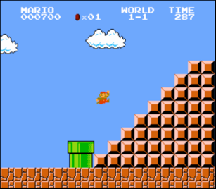

# Pyramid

Implement a program that prints half a pyramid of a height that is provided by the user.

	What height should the pyramid be? 5
	        # #
	      # # #
	    # # # #
	  # # # # #
	# # # # # #

	What height should the pyramid be? 3
	    # #
	  # # #
	# # # #

## The idea

At the end of world 1-1 in Super Mario Brothers, Mario has to climb half a pyramid of blocks before he can jump to the flagpole at the end of the level. It looks like this:

## Specification

* Create a file called `mario.py` and implement a program that builds the pyramid from Super Mario Brothers by printing hash blocks(`#`) and spaces.

* First, to make it a bit more interesting, prompt the user for the desired **height** of the pyramid.

* You can assume the user always enters a valid height: a whole number from 1 to 23. You don't have to check the input.

* Then create the half pyramid through use of `print` and one or more `for` loops.

* Note that there are zero spaces between the left bottom corner of the pyramid and the left edge of your screen!

### Constraints

Python has a lot of built-in tricks to make your life as a programmer easier. But, before you start
using those tricks it is important to be fully comfortable with the basics. So, for this
exercise there are some constraints on what you're allowed to use.

* You are only allowed to use the concepts that are discussed in this module.
For an overview of those concepts have a look [here](/python/en/overview).

* You are *not* allowed to use string multiplication (e.g., `"#"*5`) (This hasn't been discussed yet,
but if you happen to know it, don't use it.)

* You are *not* allowed to use the `import`-statement. (This hasn't been discussed yet either.)

## Tips

* Thoroughly count how many spaces and hash blocks have to be placed on each row.

* Carefully consider how you structure your `for` loops for the assignment.

## Steps

Having trouble processing everything mentioned above in one go? Here's the step by step, a common strategy for programmers:

1. First, tackle the input. Make sure the user is prompted for an input and print it to the terminal immediately.

2. Be sure to create a variable `height` that contains the value that is provided by the user.

3. Then, try to have your program print a set (`height`) amount of hash blocks on a single row.

4. Print a square of hash blocks: multiple (`height`) hash blocks on a single row and multiple (`height`) of such rows.

5. Now create a half pyramid by printing the correct amount of hash blocks on each row.

6. To round out the assignment, be sure to completely match the output of your program to that of the examples!

## Testing

Once again, first test your program yourself. Try a few heights, including 1 and 23.
Then you can test the program with `checkpy`:

	checkpy mario
